# Unidraw

**An element-based Unicode character-art studio for Obsidian.**

Unidraw combines the grid-first spirit of [ASCII Canvas](#credits), the smart
line drawing of [asciiflow](https://asciiflow.com/), and the object, element and
text workflow of [Monodraw](https://monodraw.helftone.com/) — in a native
Obsidian view with JSON `.unidraw` element files.

<p align="center">
  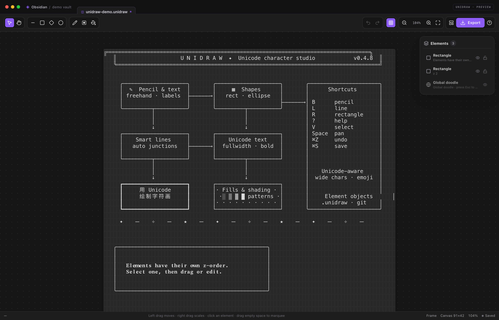
</p>

<p align="center">
  <a href="README.zh-CN.md">中文说明 →</a>
</p>

---

## Highlights

| | |
| --- | --- |
| **Elements & z-order** | Rectangles, ellipses, diamonds, lines, doodles and groups are independent elements. Every element has its own z-order, visibility and lock state, and can be selected, moved, resized and deleted. |
| **Excalidraw-style workspace** | Selecting an element opens the element inspector on the left. The canvas is built from three stacked canvases: static art, interactive selection and the new element being drawn. |
| **Real element selection** | Click an element, drag it, resize it from its corner handles, marquee several elements, Ctrl-click to add or remove, and align or distribute a multi-selection. |
| **Global doodle & groups** | Every frame starts with a global doodle pinned below all elements. It is never hit by clicks; press **Esc** to select it and draw into it. It has no handles or inspector card. Convert selected elements into a doodle, merge them into the global doodle, or group them. |
| **Unicode accuracy** | One grapheme per cell; CJK, emoji, combining marks and wide characters occupy the correct columns. |
| **Smart character lines** | Grid-snapped endpoints, 4-way/8-way routing, five line styles, interruption, independent start/end arrows, and obstacle-aware pathfinding. Endpoints auto-link to shapes. |
| **Rectangle features** | Rectangles expose optional **Text**, **Fill**, **Border** and **Interrupt** checkboxes. Each enabled feature reveals its own nested card: text layout, fill mode/swatch, stroke, or an interrupted border pattern. |
| **Element list actions** | Icon buttons toggle visibility and locking; right-click a row for duplicate/delete. Global doodle rows can clear their contents. |
| **Obsidian-native** | JSON `.unidraw` element files, `![[drawing.unidraw]]` embeds, `unidraw` code blocks, commands, ribbon action, autosave, theme-aware UI and settings. |
| **No runtime dependencies** | The plugin has no network calls and ships no fonts or external runtime libraries. |

## Screenshots

<p align="center">
  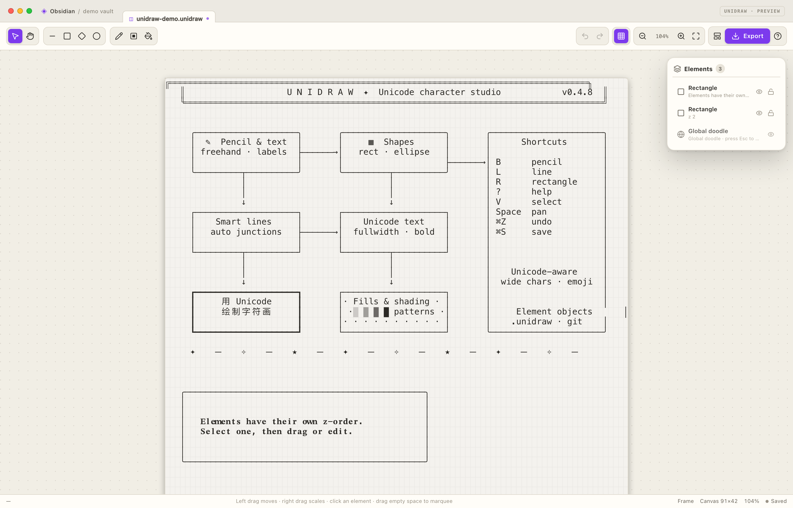
  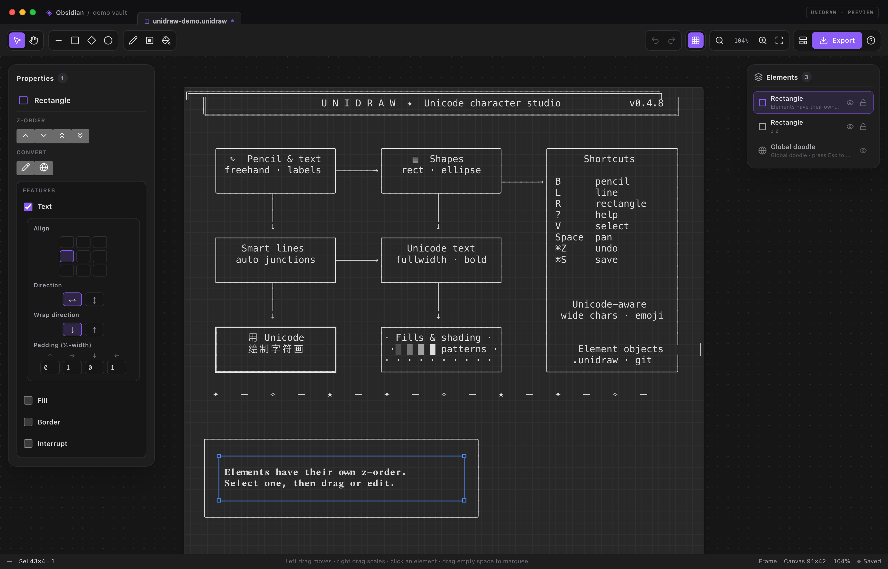
</p>
<p align="center">
  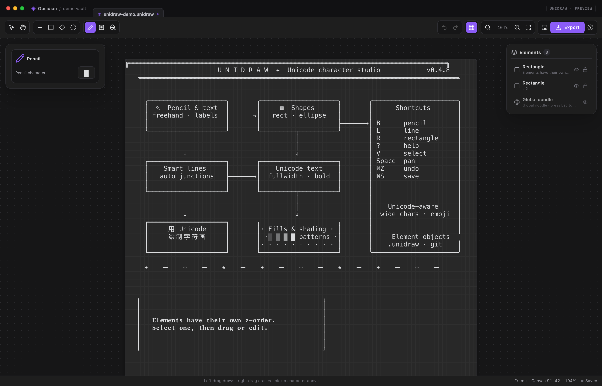
  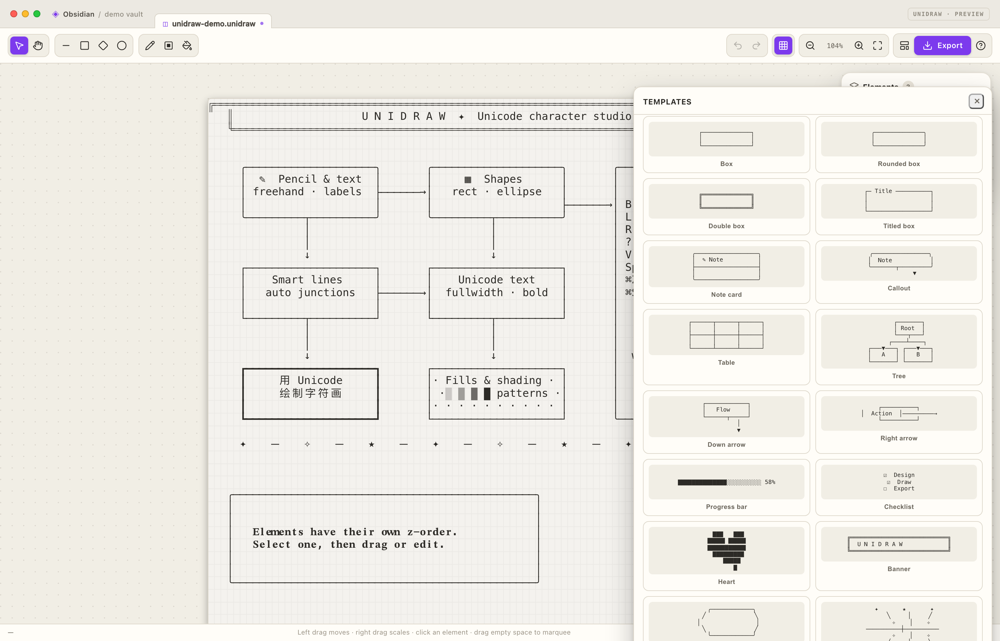
</p>
<p align="center">
  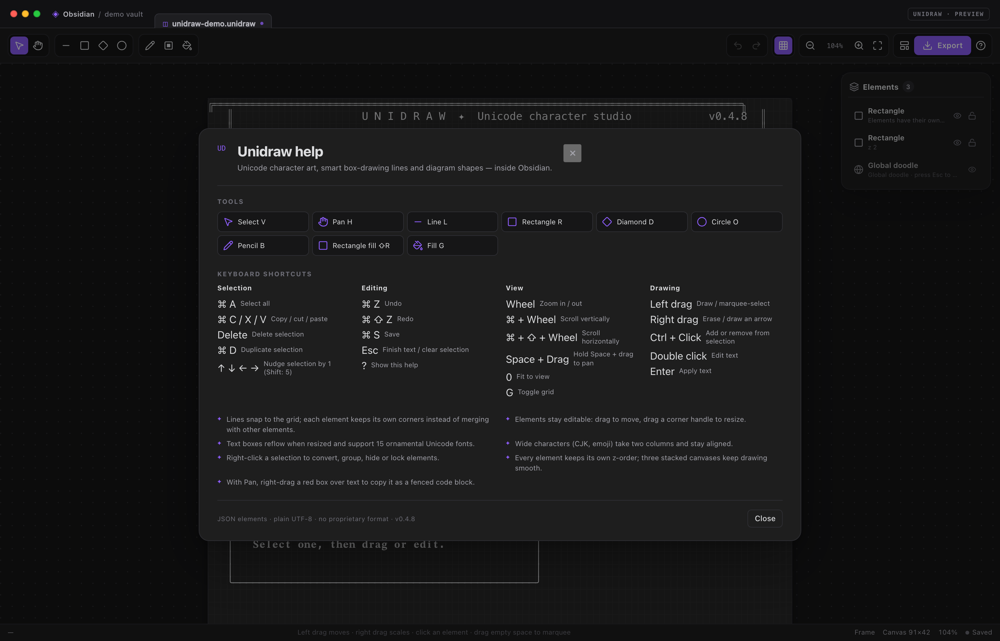
</p>

## Installation

### From the release package

Build or download `dist/unidraw-0.4.8/unidraw-0.4.8.zip`. Unzip it so that
`main.js`, `manifest.json` and `styles.css` live inside:

```text
<your-vault>/.obsidian/plugins/unidraw/
```

Then restart Obsidian, open **Settings → Community plugins**, disable Restricted
Mode if necessary, and enable **Unidraw**.

Unidraw requires **Obsidian 1.5.0 or newer**. It is not desktop-only; the
right-click tools use pointer buttons, so a desktop or mouse is recommended for
all features.

### From source

```bash
npm install
npm run build          # type-check, bundle, dist/ and release zip
npm run link -- "/path/to/vault"
```

`npm run link` creates the plugin folder link and lets Obsidian reload the
current build.

## Quick start

1. Run **Unidraw: New drawing** from the command palette, or click the ribbon
   pencil.
2. Pick a tool, then drag on the canvas. Elements are created as you go;
   drawings autosave.
3. New elements are placed on top of the frame. Use the left element
   inspector to adjust z-order, visibility and lock state.
4. Click an element with **Select**. Its bounding box and corner handles appear,
   and the property inspector opens on the left.
5. Use **Export** for PNG, transparent PNG, text, Markdown, or to insert the
   drawing into the active note.

## Workspace

- **Tool areas** — operation (Select, Pan), shapes (Line, Rectangle, Diamond,
  Ellipse), and drawing (Pencil, Rectangle fill, Fill). Text is a rectangle feature, not a tool.
- **Right element list card** — every element in top-to-bottom z-order with a type-specific icon. Drag any row directly to change its z-index; selection is not required. Groups have a chevron and expand into indented child rows, where children can be shown/hidden, locked and dragged to adjust their z-index inside the group. Click a row to select it; Ctrl/Cmd-click toggles, Shift-click selects a range. Icon-only eye and lock buttons toggle visibility and locking. The global doodle has no lock button and stays at the bottom.
- **Group inspector** — rename the group directly in the inspector title, switch
  **Separate / Merge** intersection rendering, or save the group as a JSON
  template. Templates are appended to `group-templates.json` in the plugin
  directory.
- **Left element card** — type-specific icon and title, an icon-only z-order area, an icon-only conversion area, shape/text properties, and icon-only duplicate/delete/edit actions. Visibility and lock controls live in the right element list.
- **Canvas** — grid-snapped character art built from three stacked canvases:
  **StaticCanvas** (committed elements in z-order), **InteractiveCanvas**
  (selection boxes, handles, marquee and hover) and **NewElementCanvas**
  (the temporary element being drawn or moved).
- **No contextual style bar** — tool settings live in the selected-element
  inspector; the status bar keeps the current tool hint. Pencil, filled-rectangle
  and fill tools show a small drawing-character card above the inspector even
  when nothing is selected.
- **Shape tools** switch back to the Select tool after a shape is created. The
  Select tool's first click only selects; moving starts on the following drag.
  Dragging with no selection marquee-selects.

## Tools

| Tool | Shortcut | Left drag / click | Right drag / click |
| --- | --- | --- | --- |
| Select | `V` | Marquee empty canvas; click an element to select; drag to move; double-click empty grid to create a text box | Drag to scale the selection |
| Pan | `H` | Drag to pan | Drag a red box to select text; releasing copies a fenced code block |
| Pencil | `B` | Draw the current character | Erase cells |
| Line | `L` | Draw a line | Draw an arrow |
| Outline rectangle | `R` | Draw a rectangle border | Erase the border |
| Rectangle fill | `Shift+R` | Fill a rectangular area with the current character | Erase the whole area |
| Fill | `G` | Flood-fill the contiguous region | Clear the same-character region |
| Ellipse | `O` | Draw an aspect-corrected ellipse | Erase the ellipse area |
| Diamond | `D` | Draw a diamond | Erase the diamond area |

### Keyboard and view

- **Wheel** — zoom around the pointer.
- **Ctrl/⌘ + wheel** — scroll vertically.
- **Ctrl/⌘ + Shift + wheel** — scroll horizontally.
- Hold **Space** to temporarily switch to the Pan tool; **middle-button drag** also pans. Release Space to return to the previous tool.
- **Ctrl/⌘ + A** — select every element in the frame.
- **Ctrl/⌘ + C / X / V** — copy, cut and paste objects.
- **Ctrl/⌘ + D** — duplicate the selected element(s) at the grid cell under the
  pointer, preserving their relative layout.
- **Delete / Backspace** — delete the selection.
- **Arrow keys** — nudge the selection by one cell; Shift moves five.
- **Ctrl/⌘ + Z**, **Ctrl/⌘ + Shift + Z** (or Ctrl+Y) — undo/redo.
- **?** — help and shortcuts; **0** — fit to view; **G** — toggle the grid.

### Drawing modifiers

- Right-dragging a tool performs its erase/arrow action.
- Ctrl/⌘-click an object to add or remove it from the selection.
- **Start** and **End** arrows are independent checkboxes in the line card.
  Enabling one reveals its arrow subcard.
- The adaptive arrow follows the line's direction using four cardinal arrows;
  the start arrow points outward, opposite the end arrow at the same endpoint.
- The custom mode uses any character entered in the arrow subcard.
- Endpoints snap to the character grid.

## Lines

The line object supports two routing modes:

- **4-way** — every step is horizontal or vertical, with the middle
  vertical/horizontal segment centered so the line enters the endpoint along
  the final axis instead of always making an L at the end.
- **8-way** — diagonal steps are allowed alongside horizontal/vertical steps.

Corners within one line are drawn cleanly. Separate elements do not merge with
each other: a later overlapping shape simply prints on top, so crossings never
turn into `┼`/`╬` glyphs.

Select a line to edit its routing, style, interruption, arrows and shape
ignoring in the left inspector.

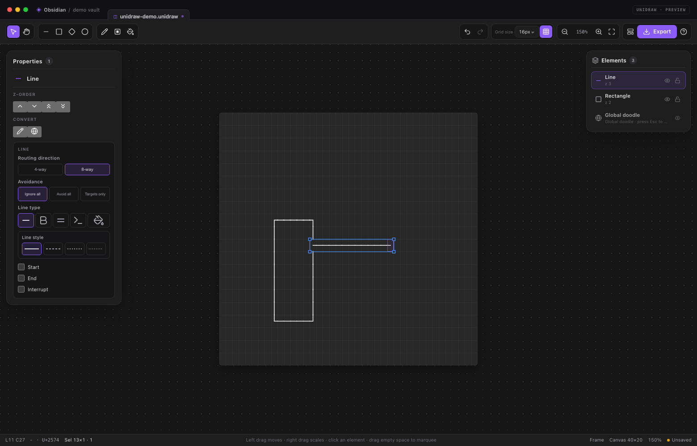

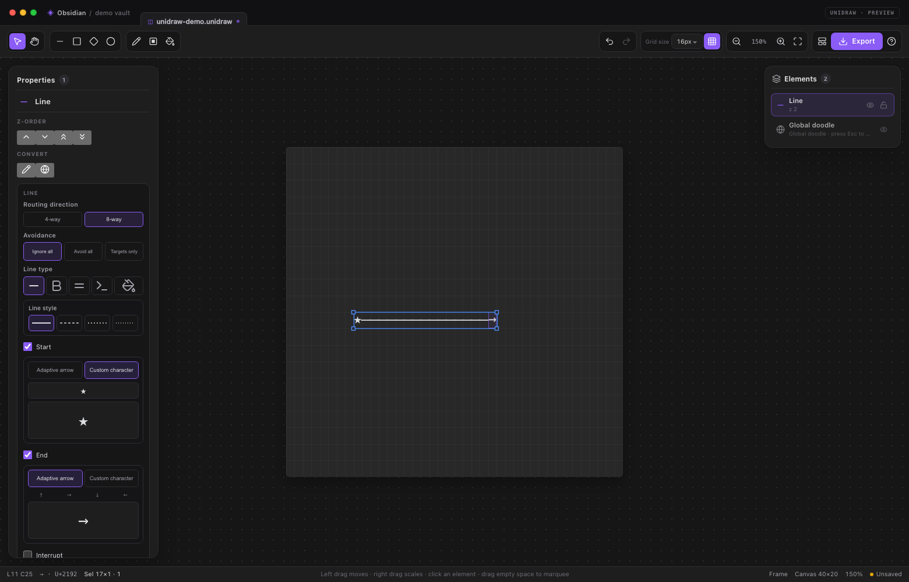

### Line settings

- **Routing direction**: **4-way** keeps every step horizontal/vertical;
  **8-way** also allows diagonals. Direct 8-way lines use a centered
  diagonal/axis/diagonal polyline so parallel `╲╲` runs are avoided.

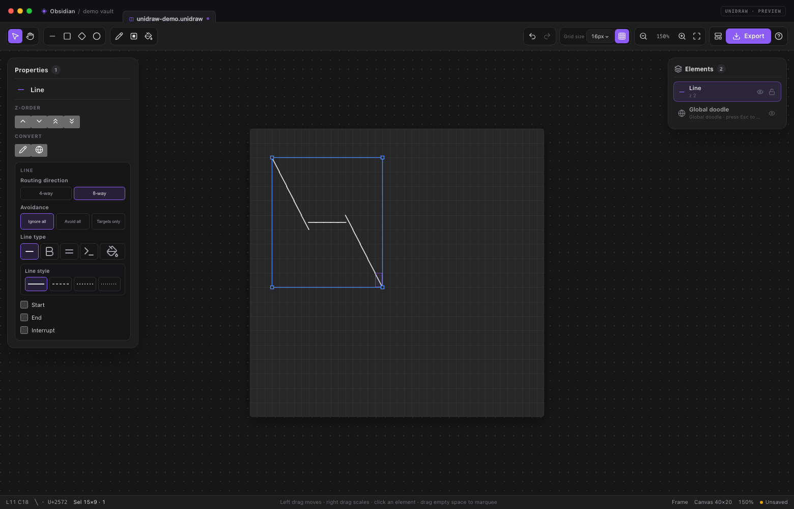
- **Avoidance**: **Ignore all**, **Avoid all** or **Targets only**.
- **Line type**: **Straight / Bold / Double / ASCII / Filled**. Bold uses the
  heavy box-drawing family; Double uses the double-line family; Filled draws
  the path with a chosen character.
- **Line style**: for Straight and Bold, choose **Solid / Dash 2 / Dash 3 /
  Dash 4**.
- **Checkboxes at the bottom**: **Start**, **End** and **Interrupt**.
  Enabled Start/End arrows reveal an **Adaptive arrow / Custom character**
  subcard. The interrupt fields use the same segment/gap/offset configuration
  as rectangle borders.
- A line endpoint dropped on or within one cell of a shape edge automatically
  links to that shape. The linked endpoint stays on the shape edge and follows
  moves or resizes. New lines start in **Do not ignore** mode, so obstacle
  avoidance is active while the link is maintained.

## Rectangle features and text

Text is no longer a separate element kind. Every rectangle has four optional
features in its element-specific card:

- **Text** — a label inside the rectangle.
- **Fill** — an empty or character fill that covers the rectangle interior.
- **Border** — the rectangle outline and stroke style.
- **Interrupt** — a segmented border pattern.

New rectangles start with **Border** on. Text is enabled with the **Text**
checkbox, by pressing **Enter**, or by double-clicking an existing label; there
is no separate text tool. Checking a feature reveals a nested card immediately
below it; unchecking it hides the subcard without discarding its saved
settings.

### Text subcard

1. Tick **Text**, or select a rectangle and press **Enter**.
2. Click the type button in the subcard or double-click an existing label.
   Editing happens **directly over the rectangle on the canvas** — no floating
   card or popup covers the board. The canvas label is hidden while the
   in-place editor is active. The editor isolates the rectangle, hiding other
   elements underneath, and matches the character-cell letter spacing, line
   height and padding of the final rendering.
   - **Enter** applies.
   - **Shift+Enter** adds a line.
   - **Esc** cancels.
   - Clicking outside applies the current text.
3. The subcard is arranged as vertical fields:
   - **Alignment** — a 3×3 grid for horizontal and vertical placement.
   - **Text direction** — horizontal or vertical.
   - **Wrap direction** — down/up or right/left.
   - **Padding** — four compact inputs marked with ↑/→/↓/← icons for top,
     right, bottom and left, measured in half-width character cells.

All buttons and inputs in the subcard are horizontally centered; only the
field labels stay left-aligned.

Font editing is no longer exposed in the subcard; existing font data remains
readable and preserved.

### Quick text boxes

With the **Select** tool, double-click an empty grid cell. Unidraw creates a
**20×5 rectangle** at that position with:

- Text on
- Border off
- Fill off

In-canvas editing starts immediately. **Esc** removes the temporary empty text
box; **Enter** or clicking outside keeps it. A confirmed box participates in
undo/redo.

### Interrupt

The **Interrupt** feature turns the rectangle border into a repeating pattern
along the perimeter (clockwise, starting at the top-left). It has three integer
fields:

- **Segment** — length of each drawn segment, minimum 1.
- **Gap** — length of each skipped segment, minimum 1.
- **Offset** — shifts the pattern, minimum 0.

Enabling Interrupt also turns on the Border feature. The current line style,
fill and text are preserved. The pattern is saved with the element.

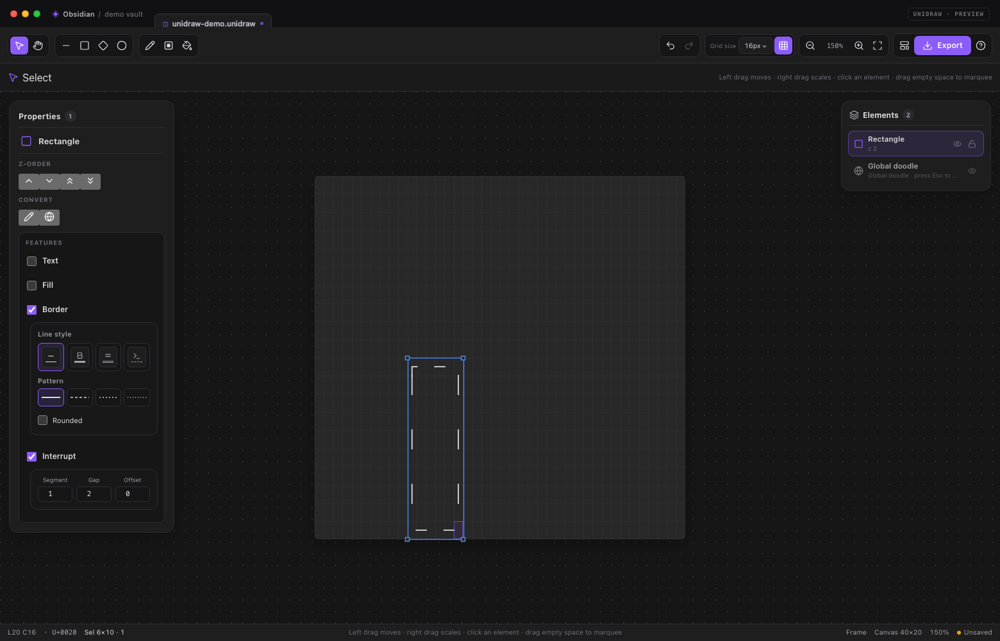

Text that does not fit is clipped. The rectangle keeps its Text/Fill/Border/
Interrupt feature flags when saved, moved, resized, copied or deleted.

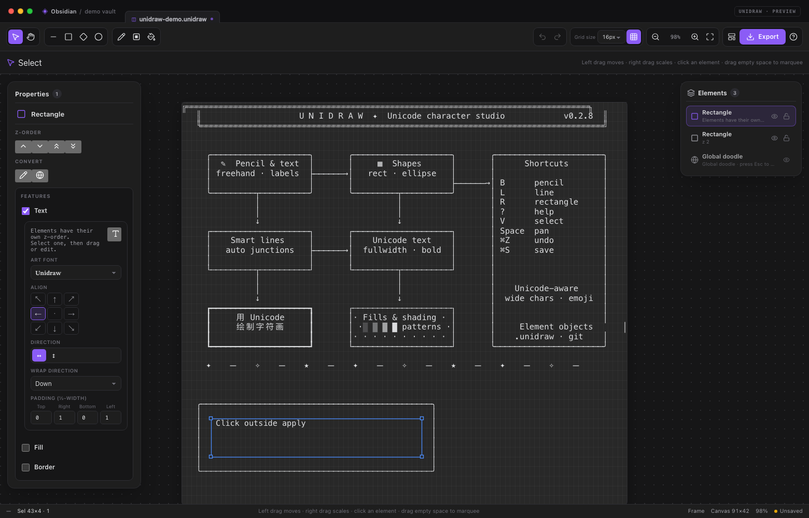

### Fill and border subcards

- **Fill** uses three icon-only tabs (tooltips name each mode) with preview
  swatches:
  - **Empty** — covers the interior with blanks.
  - **Block** — opens a grid of shaded/block glyphs.
  - **Custom** — opens the fill-character picker for any glyph.
  Turning Fill off is true transparency.

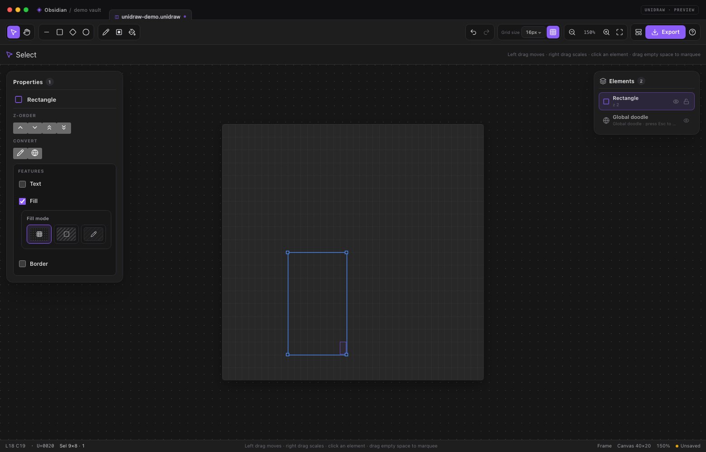

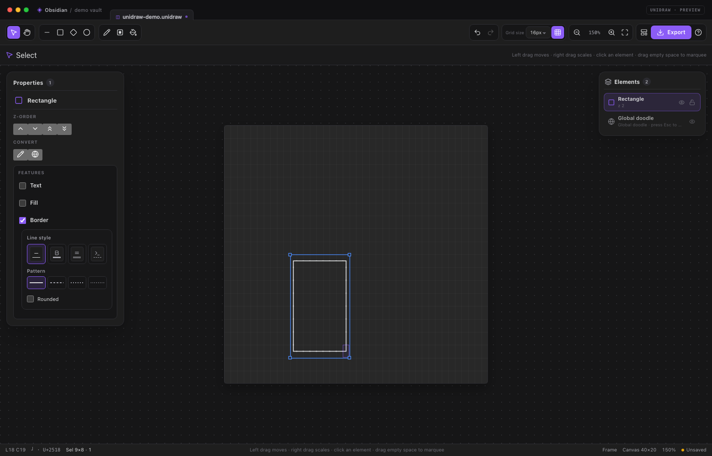
- **Border** uses a tabbed line-style card:
  - Four icon-only tabs: **Straight / Bold / Double / ASCII**, each with a
    tooltip and a CSS line preview.
  - **Straight** and **Bold** reveal four pattern presets:
    **Solid / Dash 2 / Dash 3 / Dash 4**. Each has a CSS line preview and a
    corresponding Unicode stroke family.
  - **Rounded** is available only for **Straight** and restores the previous
    light style when unchecked.
  - **Double** and **ASCII** hide the pattern/rounded extras, so the detail
    area changes with the selected tab.
  Turning Border off leaves the fill and text intact.

## Elements, selection and transforms

Everything drawn on the frame is an **element**:

| Element | Created by |
| --- | --- |
| `rectangle` | Rectangle tool and every rectangle, including text labels |
| `ellipse` | Ellipse/circle tool |
| `diamond` | Diamond tool |
| `line` | Line tool, or right-drag for an arrow |
| `doodle` | Pencil, solid rectangle, fill, or converting elements |
| `group` | Merging two or more selected elements |

- Right-click the **global doodle** row in the element list to **clear its
  contents**; the doodle itself stays in place and the action is undoable.
- Every frame starts with a **global doodle** pinned at the bottom of the stack.
  It cannot be clicked, moved or re-ordered. Press **Esc** to select it (and
  **Esc** again to release it); it is drawn with a quiet outline, no handles and
  no inspector card. Drawing while it is selected adds to the global doodle.
  Converting to global doodle merges the selected elements into it.
- New elements are appended to the top of the frame.
- Doodles cannot be scaled with selection handles. Use the drawing tools to
  change their contents instead.
- Drawing-area tools paint into an existing doodle only: the selected doodle,
  otherwise the non-global doodle under the pointer, otherwise the global
  doodle. They never create a new doodle element.
- **Click** an element to select it; **marquee** on empty canvas to select
  several; **Ctrl/⌘-click** to add or remove.
- Drag a selected element to move it; drag a corner handle to resize.
- **Delete** removes selected elements from the row context card. The global
  doodle is protected.
- Elements whose visible content is completely erased are removed
  automatically, except the global doodle.
- The icon-only **Z-order** area moves the selection one step forward or
  backward, or brings it to the front/back. The icon-only **Convert** area
  contains convert-to-doodle and convert-to-global; merge-into-group appears
  only when multiple elements are selected.
- Closed shapes (rectangle, ellipse, diamond) have a **Fill** setting:
  - **No fill** — transparent; elements underneath remain visible.
  - **Empty fill** — covers the interior with blanks; elements underneath are
    hidden.
  - **Character fill** — covers the interior with the chosen glyph.
  A filled shape always covers what is underneath it; empty fill is different
  from no fill. Dragging a shape previews the final frame directly; a single
  click creates `□` (rectangle), `◇` (diamond) or `○` (ellipse). Moving and
  resizing are not limited to the current auto-fit board; the canvas grows
  live while extending or moving past its edge, and transforms still render in
  z-order.
- With the **Pan** tool, **right-drag** selects a rectangle of text with a red
  marquee. Releasing copies it to the clipboard as a plain fenced code block
  that can be pasted into another note. **Esc** clears the red text selection.
- With the **Select** tool, **right-drag** inside the selection scales it.
- Drawing-area tools (Pencil, Rectangle fill and Fill) only modify doodles. If
  a single doodle is selected it is the target; otherwise the non-global doodle
  under the pointer is focused, falling back to the global doodle. Drawing-area
  tools never create a new doodle element.
- **Visibility** and **lock** are stored per element and are toggled from the
  right element list. Locked elements cannot be selected, moved or edited with
  the left mouse button; unlock them with the row's unlock button. The global
  doodle has no lock control and remains Esc-only.
- Use the element list's row actions for visibility/lock and its right-click
  card for duplicate/delete. The Select tool's canvas right-click no longer
  opens an old context menu.
- A selected rectangle shows a **Features** card with **Text**, **Fill**,
  **Border** and **Interrupt** checkboxes. Each checked feature opens its own
  nested settings card. Text is a rectangle feature; enable it with the Text
  checkbox or Enter.

## Grid, canvas and view

- Fixed **16 px** character cells; the grid-size selector has been removed.
- Toggle grid lines from the toolbar; the setting is saved with the plugin.
- The canvas has no fixed edge in normal use: objects expand it as needed.
- Minimum canvas width and height are stored per drawing.
- Erasing content below the minimum/visible bounds automatically contracts the
  canvas.
- Zoom range 20–400%; zoom, pan and fit are preserved in the status bar.

## Files and embeds

A `.unidraw` file is a UTF-8 JSON element document (single frame):

```json
{
  "format": "unidraw",
  "version": 1,
  "minCols": 40,
  "minRows": 20,
  "activeLayerId": "frame-1",
  "layers": [
    {
      "id": "frame-1",
      "name": "Frame",
      "visible": true,
      "locked": false,
      "objects": [
        {
          "id": "doodle-global",
          "kind": "cells",
          "role": "draw",
          "global": true,
          "cells": []
        },
        {
          "id": "line-1",
          "kind": "line",
          "x1": 2, "y1": 2, "x2": 20, "y2": 8,
          "style": "light",
          "route": "elbow",
          "arrowStart": "none",
          "arrowEnd": "solid"
        }
      ]
    }
  ]
}
```

Existing plain-text `.unidraw` files are still imported: the text becomes one
global doodle element, so older drawings open without migration steps. Text exports
and code blocks remain plain character art.

Embed a drawing in a note:

```md
![[my-diagram.unidraw]]
```

or keep the art directly in a code block:

````md
```unidraw
╭──────────────╮
│  Hello 🌍     │
╰──────────────╯
```
````

File embeds render in Reading view with a copy/open bar and read the latest file
contents. The code-block form is self-contained and uses the monospace font.

## Export

The **Export** menu offers:

- **Copy as text** — the composed character art.
- **Copy as Markdown** — a `unidraw` fenced block.
- **Copy as image** — PNG to the clipboard where supported.
- **Export PNG** — theme-coloured PNG at 2× resolution.
- **Export transparent PNG** — transparent background.
- **Export text file** — saves `.txt` beside the current drawing (downloads in
  the standalone demo).
- **Export Markdown file** — saves `.md` with a fenced art block beside the
  current drawing.
- **Insert into active note** — inserts a fenced block at the cursor.

The current release lives in **`dist/unidraw-0.4.8/`**: the three plugin
files plus `unidraw-0.4.8.zip`. Previous releases are kept compressed in
**`dist/backup/`** (`unidraw-0.1.0/`, `unidraw-0.2.0/`, `unidraw-0.2.1/` … `unidraw-0.4.7/`).

## Settings

Open **Settings → Unidraw** for:

- Interface language (automatic, English, Chinese).
- Fixed grid size: 16 px.
- Canvas font family and line height.
- Grid style (dots/lines/off).
- Default stroke, default text style and pencil character.
- Autosave and delay.
- Status bar visibility.
- Embedded drawing font size and line height.

The active drawing grows and shrinks with its visible content; the minimum canvas size is stored in the document.

## Commands

- Unidraw: New drawing
- Unidraw: New drawing from selection
- Unidraw: Undo / Redo
- Unidraw: Copy drawing as text
- Unidraw: Export drawing as PNG
- Unidraw: Insert current drawing into note
- Unidraw: Toggle canvas grid
- Unidraw: Fit drawing to view
- Unidraw: Open help & shortcuts

## Architecture

```text
src/
  core/       element model, JSON file format, Unicode grid, history, i18n
  model/      element rasterization, line routes, diamond, group, text layout
  glyphs/     box-drawing tables, strokes, fills, Unicode typefaces
  editor/     tool state machine, element selection, transforms, z-order, undo
  render/     three stacked canvases, previews, theme colours, PNG export
  ui/         toolbar, left element inspector, context menus, popovers
  view/       Obsidian ItemView and reading-mode embeds
  main.ts     plugin entry, commands, processors, settings tab
  settings.ts settings schema and settings UI
```

The editor core has no Obsidian runtime dependency. `demo/` mounts the same UI
with a small mock host, and the screenshot pipeline in `scripts/` uses headless
Chrome to generate the documentation images.

### Seamless Unicode rendering

Box-drawing (`U+2500–U+257F`), block (`U+2580–U+259F`) and braille
(`U+2800–U+28FF`) glyphs are drawn with vector geometry in the editor and PNG
export, avoiding the seams that monospace fonts leave at cell boundaries.
Regular text, CJK and emoji use the configured font. Reading-mode embeds use the
font directly, so they can show tiny seams depending on the installed font.

## Development

```bash
npm install
npm run dev          # watch mode, bundles main.js
npm run build        # type-check, bundle, zip and package dist/
npm test             # 59 unit tests for the grid, elements, fills and shapes
npm run demo         # build the browser demo
npm run screenshot   # capture the documentation screenshots (Chrome required)
npm run link -- /path/to/vault
```

`npm run build` produces `dist/unidraw-0.4.8/main.js`,
`dist/unidraw-0.4.8/manifest.json`, `dist/unidraw-0.4.8/styles.css` and
`dist/unidraw-0.4.8/unidraw-0.4.8.zip`, while leaving `dist/backup/` untouched.

The screenshot script uses `CHROME_PATH` if set, otherwise the macOS Chrome
location, and drives Chrome through the DevTools Protocol with a temporary
profile.

## Credits

Unidraw was inspired by:

- [ASCII Canvas](https://github.com/h4kbas/obsidian-ascii) by **Huseyin Akbas** —
  a minimal ASCII-only canvas plugin and structural reference.
- [asciiflow](https://asciiflow.com/) — fast keyboard-friendly box-line drawing
  and smart intersections.
- [Monodraw](https://monodraw.helftone.com/) — professional character-art
  elements, groups, text and export.

Unicode character data is defined by the [Unicode Standard](https://unicode.org/).
The demo uses [Lucide](https://lucide.dev/) icons; Obsidian provides its own
icon set at runtime. No fonts are bundled.

## License

MIT. See [LICENSE](LICENSE).
