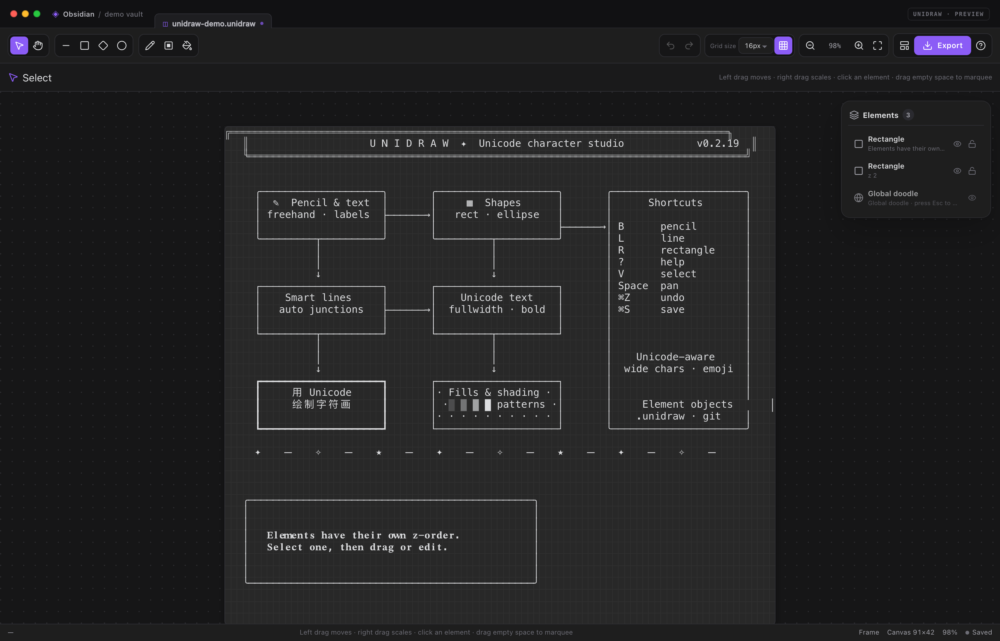
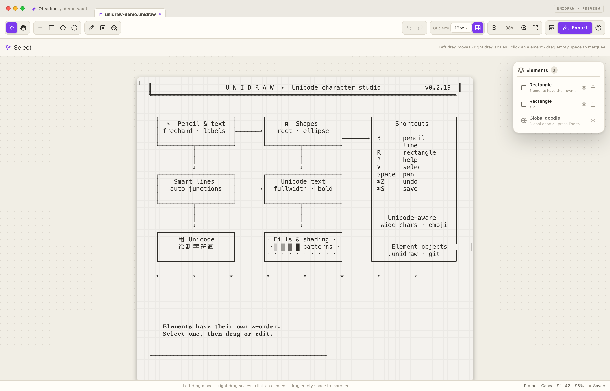
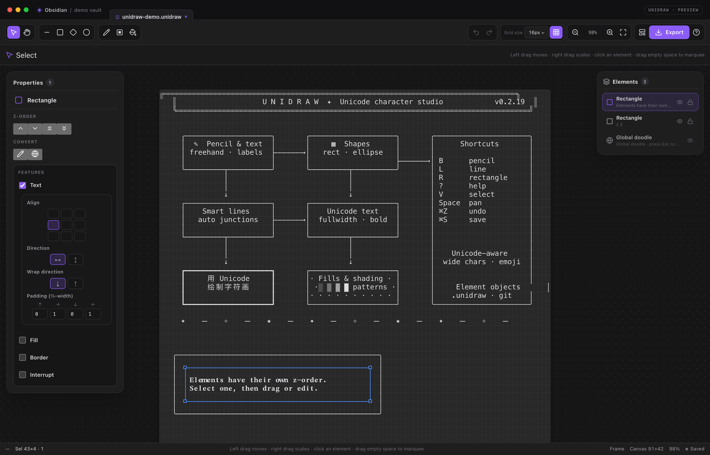
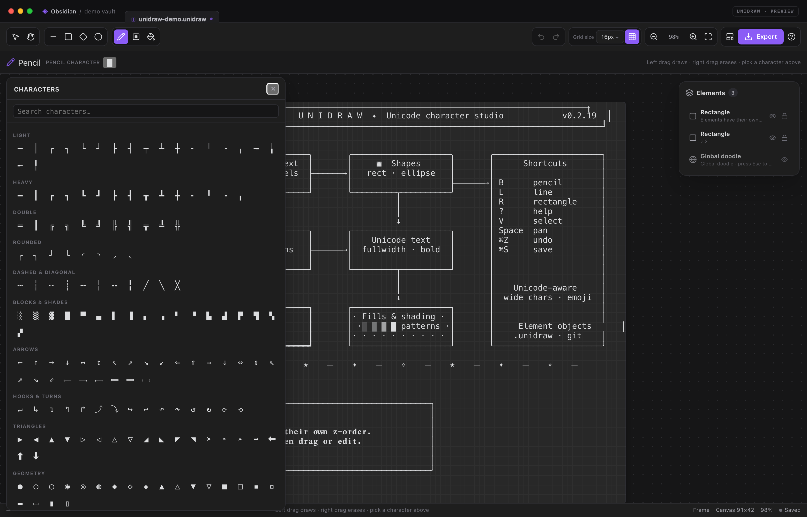
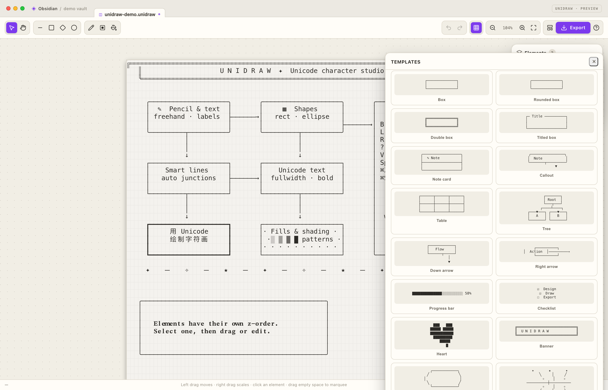
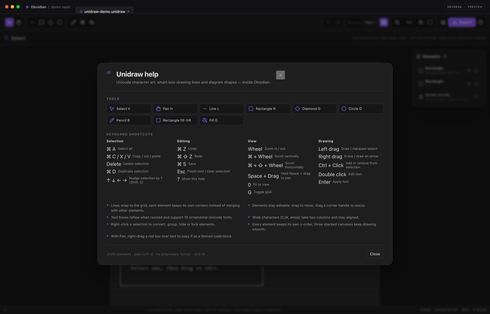
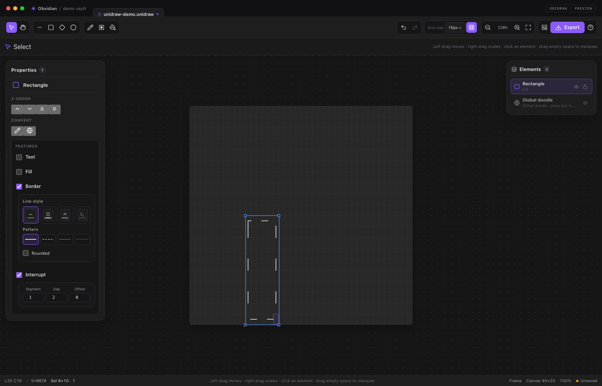
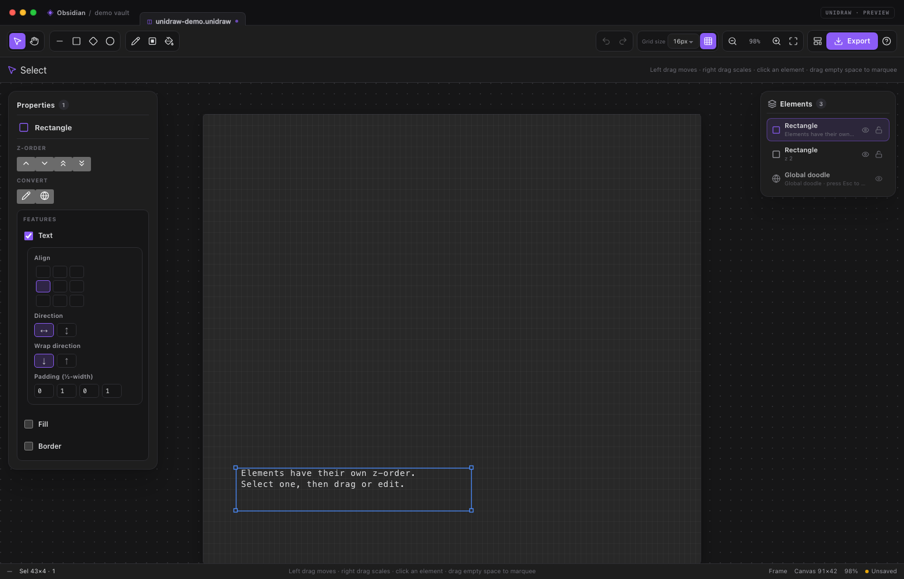
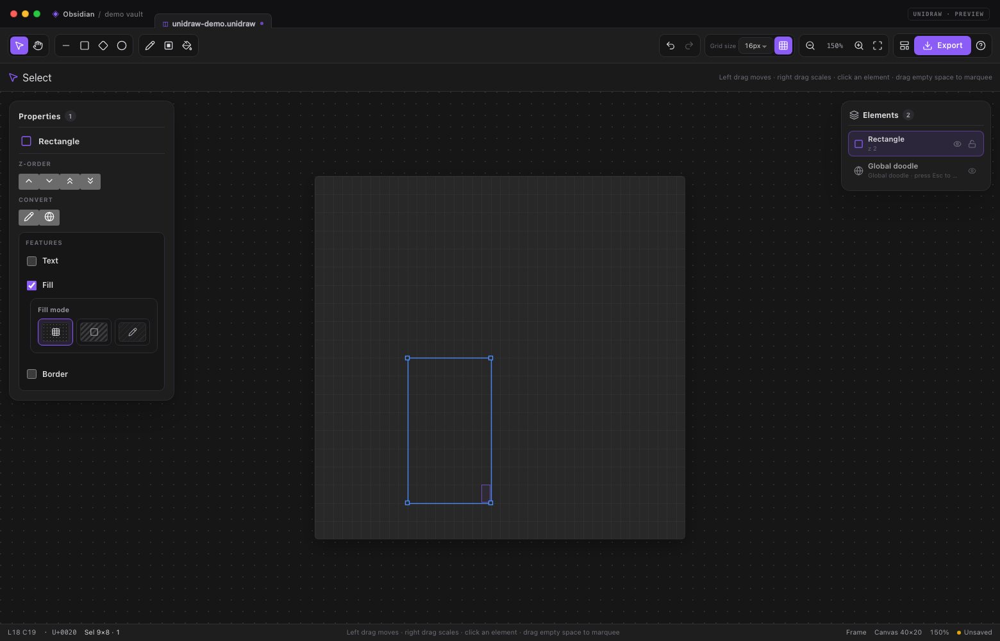
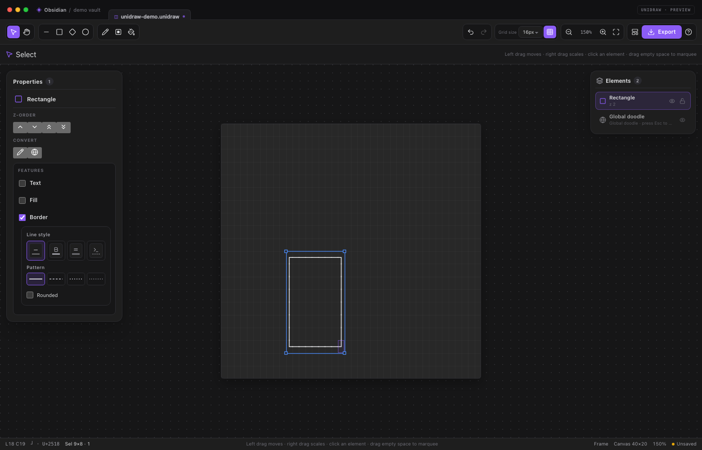

# Unidraw

**基于元素的 Unicode 字符画工作室，原生运行在 Obsidian 中。**

Unidraw 结合了 [ASCII Canvas](#致谢) 的网格绘制、[asciiflow](https://asciiflow.com/)
的智能线条，以及 [Monodraw](https://monodraw.helftone.com/) 的元素、层级和文字
工作流，并使用 Obsidian 原生的 `.unidraw` JSON 元素文件。

<p align="center">
  
</p>

<p align="center">
  <a href="README.md">English →</a>
</p>

---

## 特性

| | |
| --- | --- |
| **元素与层级** | 矩形、椭圆、菱形、线、涂鸦和集合都是独立元素，可选中、移动、缩放和删除，并拥有独立的层级、可见性和锁定状态。 |
| **Excalidraw 风格工作区** | 选中元素后左侧弹出元素检查器；画布由静态、交互、新元素三张叠加画布组成。 |
| **真正的对象选择** | 点击选中、拖动移动、拖拽角点缩放、框选多个对象、Ctrl 点击加选/减选，并支持对齐与等距分布。 |
| **全局涂鸦与集合** | 每个画框默认存在全局涂鸦，固定在所有元素下方；点击不会选中，按 **Esc** 选中后才能画进去，且没有控制点或编辑卡片。可将选中元素转换为涂鸦、合并进全局涂鸦，或合并为集合。 |
| **Unicode 精确网格** | 一个字符簇占一个格子；中文、日文、Emoji、组合音标和宽字符占正确列数。 |
| **智能字符线条** | 端点吸附网格；三种走线模式；起点/终点箭头样式可分别设置；每个元素保留自己的拐角，不同元素按层级覆盖而不会合并出 `┼`/`╬`。 |
| **矩形功能开关** | 矩形提供可选的**文本**、**填充**、**边框**、**间断**四个复选框；开启后各自展开嵌套设置卡片：文字排版、填充方式/字符、边框描边或间断边框图案。 |
| **列表操作** | 行内图标切换显示/锁定；右键行弹出复制/删除；全局涂鸦行可清空内容。 |
| **Obsidian 原生** | 纯文本 JSON `.unidraw` 文件、`![[drawing.unidraw]]` 嵌入、`unidraw` 代码块、命令、Ribbon、自动保存和设置页。 |
| **零运行时依赖** | 插件不联网、不捆绑字体、不依赖外部运行时库。 |

## 截图

<p align="center">
  
  
</p>
<p align="center">
  
  
</p>
<p align="center">
  
</p>

## 安装

### 使用发布包

从 [`dist/unidraw-0.2.19/`](dist/unidraw-0.2.19/) 获取
`unidraw-0.2.19.zip`，解压后确保以下文件位于：

```text
<你的仓库>/.obsidian/plugins/unidraw/
```

即 `main.js`、`manifest.json` 和 `styles.css`。重启 Obsidian，进入
**设置 → 第三方插件**，必要时关闭安全模式，然后启用 **Unidraw**。

需要 **Obsidian 1.5.0 或更高版本**。右键工具需要鼠标，桌面端体验最佳。

### 从源码构建

```bash
npm install
npm run build          # 类型检查、打包、dist/ 和发布 zip
npm run link -- "/path/to/vault"
```

`npm run link` 会把插件目录链接到仓库，方便 Obsidian 重新加载最新构建。

## 快速开始

1. 从命令面板执行 **Unidraw: 新建字符画**，或点击 Ribbon 铅笔图标。
2. 选择工具，在画布上拖动；元素会自动创建并自动保存。
3. 新元素默认置于画框顶部；在左侧检查器中调整层级、可见性和锁定状态。
4. 使用**选择**工具点击对象：会出现蓝色边界框和角点，左侧打开属性面板。
5. 点击**导出**，可复制 PNG、透明 PNG、文本、Markdown，或插入当前笔记。

## 工作区

- **工具区** — 操作区（选择、平移）、形状区（直线、矩形、菱形、椭圆）、绘制区（铅笔、矩形填充、填充）。文字是矩形功能，不再是独立工具。
- **画布** — 网格字符画，由静态、交互、新元素三张叠加画布组成；左侧是选中元素的编辑卡片，右侧是所有元素的列表卡片。列表行带类型图标和仅图标的显示/锁定按钮；支持 Ctrl/⌘ 点击间断多选、Shift 点击连续多选，拖动行可调整层级。全局涂鸦没有锁定按钮。
- **左侧元素检查器** — 类型图标、图标式层级区、图标式转换区、形状/文字属性和图标式复制/删除/编辑按钮；显示和锁定操作在右侧元素列表中。
- **上下文样式栏** — 当前工具的线条样式、走线、箭头样式、字体和字符选择器。

## 工具

| 工具 | 快捷键 | 左键拖动/点击 | 右键拖动/点击 |
| --- | --- | --- | --- |
| 选择 | `V` | 空白处框选；点击元素选中；拖动移动；双击空白网格快速创建文本框 | 拖拽缩放当前选区 |
| 平移 | `H` | 拖动平移 | 拖拽红色选框选择文本；松开后复制为代码块 |
| 铅笔 | `B` | 用当前字符绘制 | 擦除格子 |
| 线条 | `L` | 绘制线条 | 绘制箭头 |
| 空心矩形 | `R` | 绘制矩形边框 | 擦除边框 |
| 矩形填充 | `Shift+R` | 用当前字符填充矩形区域 | 擦除整个区域 |
| 填充 | `G` | 对连通区域填充 | 清除相同字符区域 |
| 椭圆 | `O` | 绘制按像素比例修正的椭圆 | 擦除椭圆区域 |
| 菱形 | `D` | 绘制菱形 | 擦除菱形区域 |

### 键盘与视图

- **滚轮** — 以指针为中心缩放。
- **Ctrl/⌘ + 滚轮** — 纵向滚动。
- **Ctrl/⌘ + Shift + 滚轮** — 横向滚动。
- 按住 **空格** 临时切换到平移工具；释放后回到原工具。**中键拖动**也可平移。
- **Ctrl/⌘ + A** — 选中画框内所有元素。
- **Ctrl/⌘ + C / X / V** — 复制、剪切、粘贴对象。
- **Ctrl/⌘ + D** — 将选中元素（可多选）复制到当前指针所在的网格处，并保留相对布局。
- **Delete / Backspace** — 删除选中对象。
- **方向键** — 微移 1 格；按住 Shift 微移 5 格。
- **Ctrl/⌘ + Z**、**Ctrl/⌘ + Shift + Z**（或 Ctrl+Y）— 撤销/重做。
- **?** — 帮助与快捷键；**0** — 适应视图；**G** — 显示/隐藏网格。

### 操作约定

- 右键拖动工具执行擦除/箭头操作。
- Ctrl/⌘ 点击对象可加选或减选。
- 线条工具栏可分别设置**起点**和**终点**箭头：无、单线、空心、实心。
- 线条端点吸附到字符网格。

## 线条

线条对象支持三种走线模式：

- **纯直线** — 在两个吸附端点之间直接绘制。
- **斜线 + 横线** — 先绘制 45° 斜线段，再用横线/竖线连接到终点。
- **折线** — 两段正交的直角连接线。

线条样式（细线、粗线、双线、圆角、虚线、ASCII）作用于整个对象。线条与已有
同一个线条内部的拐角会正常处理；不同元素之间不会互相合并，后绘制的元素直接覆盖，交叉处不会出现 `┼`、`╬` 等连接符。

选中线条后，可在左侧属性面板中修改样式、走线和起点/终点箭头。

## 矩形功能与文字

文字不再是独立元素类型。每个矩形在元素特有属性卡片中提供三个可选功能：

- **文本** — 矩形内部的文字标签。
- **填充** — 空填充或字符填充，覆盖矩形内部。
- **边框** — 矩形轮廓及描边样式。

新建矩形默认开启**边框**。文本通过**文本**复选框、**Enter** 或双击已有文字启用，
没有单独的文字工具。勾选功能后，下方立即展开对应的嵌套子卡片；取消勾选只隐藏
子卡片，不丢弃已保存设置。

### 文本子卡片

1. 勾选**文本**，或选中矩形后按 **Enter**。
2. 点击子卡片中的文字按钮，或双击已有文字。编辑**直接覆盖在画布上的矩形内完成**，
   不会弹出浮动卡片或遮住画布。编辑时画布中的原文字会隐藏，其他元素也会暂时隐藏，
   并且编辑框会按最终渲染的字符格宽、行高和内边距对齐。
   - **Enter** 应用。
   - **Shift+Enter** 换行。
   - **Esc** 取消。
   - 点击外部区域会应用当前文字。
3. 子卡片按纵向字段排布：
   - **对齐方式** — 3×3 九宫格，控制水平、垂直对齐。
   - **文字方向** — 横排 / 竖排。
   - **换行方向** — 向下/向上或向右/向左。
   - **内边距** — 四个紧凑输入框，分别以上、右、下、左图标标注，以半角字符数计量。

子卡片内除字段标题外，所有按钮和输入框均水平居中；字段标题保持左对齐。

子卡片不再显示字体编辑；已有字体数据仍会保留并可正常读取。

### 快速文本框

使用**选择工具**双击空白网格：会在该位置创建一个 **20×5** 的矩形，并自动：

- 开启文本
- 关闭边框
- 关闭填充

随后直接进入画布内编辑。按 **Esc** 会删除这个尚未确认的临时文本框；按 **Enter**
或点击外部会保留。确认后的文本框参与撤销/重做。

### 间断

**间断**功能会把矩形边框变成沿周长重复的图案，从左上角开始顺时针排列。子卡片包含三个整数输入：

- **单段长度** — 每段绘制长度，最小 1。
- **间断长度** — 每段跳过长度，最小 1。
- **偏移** — 图案相位偏移，最小 0。

开启间断会自动开启边框功能；原有线条样式、填充和文字保持不变。图案会随元素保存。



超出矩形的内容会被裁剪。文本/填充/边框/间断的功能开关会随文件保存，并随元素移动、
缩放、复制和删除。



### 填充与边框子卡片

- **填充**使用三个纯图标选项卡（悬停显示名称）和预览底纹：
  - **空** — 用空白覆盖内部。
  - **色块** — 展开色块字符网格供选择。
  - **自定义** — 展开填充字符选择器，可指定任意字符。
  关闭填充才是真正透明。
- **边框**使用选项卡式线条样式：
  - **直线 / 加粗 / 双线 / ASCII** 四个纯图标选项卡，悬停显示名称，并显示线条预览。
  - 选择**直线**或**加粗**时，下方显示四种线型：**实线 / 虚线2 / 虚线3 / 虚线4**。每种都有线条预览和对应的 Unicode 描边字族。
  - **圆角**只支持**直线**选项卡；取消勾选会恢复之前的细线样式。
  - 选择**双线**或 **ASCII** 时隐藏线型和圆角附加项，因此选项卡下方内容会随选择变化。
  关闭边框不会影响填充和文字。





## 元素、选择与变换

画布上的所有内容都是**元素**：

| 元素 | 创建方式 |
| --- | --- |
| `rectangle` | 矩形工具及所有带文字的矩形 |
| `ellipse` | 椭圆/圆形工具 |
| `diamond` | 菱形工具 |
| `line` | 线工具；右键拖动创建箭头 |
| `doodle` | 铅笔、实心矩形、填充，或转换元素 |
| `group` | 将两个及以上选中元素合并 |

- 在右侧元素列表中右键**全局涂鸦**行，可选择**清空全局涂鸦**内容；全局涂鸦本身保留，操作可撤销。
- 每个画框默认存在一个**全局涂鸦**元素，固定在层级最底部，不能点击选中、移动或调整层级。按 **Esc** 选中它（再按一次释放），选中时只有低调的虚线标记，没有控制点，也不会弹出编辑卡片；此时绘制会画进全局涂鸦。转换为全局涂鸦会把选中元素合并进去。
- 新元素默认置于当前画框顶部。
- 如果当前只选中一个涂鸦元素，接下来的绘制操作默认画进该涂鸦，而不是新建元素。
- **点击**元素选中；在空白处拖动**框选**多个元素；**Ctrl/⌘ 点击**增减选择。
- 拖动选中元素移动；拖动角点缩放。
- 右键元素列表中的行可弹出复制/删除小卡片；全局涂鸦受保护，不可删除。内容被完全擦除的元素会自动删除，全局涂鸦除外。
- 检查器的图标式**层级区**可将选区上移/下移一层、置顶或置底；图标式**转换区**包含转换成涂鸦和转换成全局涂鸦，选择多个元素时才显示合并为集合。
- 闭合形状（矩形、椭圆、菱形）支持**填充**设置：
  - **无填充** — 透明，形状下方的其他元素仍然可见；
  - **空填充** — 用空白覆盖内部，形状下方的信息被遮住；
  - **字符填充** — 用指定字符覆盖内部。
  空填充不是无填充；只要设置了填充，就会覆盖形状内部下方的内容。拖拽形状时直接预览最终边框；单击会输入 `□`（矩形）、`◇`（菱形）或 `○`（椭圆）。移动和缩放不再受当前自适应画板大小限制；超出边缘时画板会实时扩展，并仍按层级渲染。
- 使用**平移工具右键拖拽**可用红色选框选择文本；松开后自动复制为纯文本代码块，可直接粘贴到其他笔记。按 **Esc** 清除红色文本选区。
- 使用**选择工具右键拖拽**可缩放当前选区。选择工具的画布右键不再弹出旧快捷菜单。
- 涂鸦元素不能通过选择框缩放，只能通过绘制工具修改内容。
- 绘制区工具（铅笔、矩形填充、填充）只修改已有涂鸦：如果当前选中单个涂鸦，则直接作用于它；否则聚焦光标下的非全局涂鸦，没有则聚焦全局涂鸦。绘制区工具不会新建涂鸦元素。
- 每个元素独立保存**可见性**和**锁定**状态，并可在右侧元素列表中用图标按钮切换。锁定元素无法通过左键选中、移动或编辑；可用行内解锁按钮恢复。全局涂鸦没有锁定按钮，仍只能通过 Esc 选中。
- 元素列表行右键可复制/删除；选择工具的画布右键不再打开旧快捷菜单。
- 选中单个矩形时，编辑卡片显示 **功能** 区：**文本**、**填充**、**边框**、**间断**四个复选框。每个开启的功能会在下方展开自己的嵌套设置卡片。文字是矩形功能；通过文本复选框或 Enter 启用。

## 网格、画布与视图

- 网格大小：**4、8、12、16 px** 字符格子。
- 工具栏可显示/隐藏网格线，设置会随插件保存。
- 画布没有固定边界，对象会按需要扩展画布。
- 每个字符画可设置最小画布宽高。
- 擦除后若可见内容小于最小/当前尺寸，画布会自动收缩。
- 缩放范围 20%–400%；状态栏显示缩放和画布尺寸。

## 文件与嵌入

`.unidraw` 是 UTF-8 JSON 元素文档（单画框）：

```json
{
  "format": "unidraw",
  "version": 1,
  "minCols": 40,
  "minRows": 20,
  "activeLayerId": "frame-1",
  "layers": [
    {
      "id": "frame-1",
      "name": "Frame",
      "visible": true,
      "locked": false,
      "objects": [
        {
          "id": "doodle-global",
          "kind": "cells",
          "role": "draw",
          "global": true,
          "cells": []
        },
        {
          "id": "line-1",
          "kind": "line",
          "x1": 2, "y1": 2, "x2": 20, "y2": 8,
          "style": "light",
          "route": "elbow",
          "arrowStart": "none",
          "arrowEnd": "solid"
        }
      ]
    }
  ]
}
```

旧版纯文本 `.unidraw` 文件仍然可以导入：文本会变成一个全局涂鸦元素，无需手动迁移。
文本导出和代码块仍然是纯字符画。

在笔记中嵌入：

```md
![[my-diagram.unidraw]]
```

也可以直接在代码块中保存字符画：

````md
```unidraw
╭──────────────╮
│  Hello 🌍     │
╰──────────────╯
```
````

文件嵌入在阅读视图中渲染，带复制/打开栏，并读取仓库中的最新内容。代码块形式
自包含，并使用等宽字体显示。

## 导出

**导出**菜单提供：

- **复制为文本** — 合成后的字符画。
- **复制为 Markdown** — `unidraw` 代码块。
- **复制为图片** — 平台支持时复制 PNG。
- **导出 PNG** — 2 倍分辨率、主题颜色。
- **导出透明 PNG** — 透明背景。
- **导出文本文件** — `.txt`。
- **导出 Markdown 文件** — 带代码块的 `.md`。
- **插入当前笔记** — 在光标处插入代码块。

当前版本位于 **`dist/unidraw-0.2.19/`**：包含三个插件文件和
`unidraw-0.2.19.zip`。过往版本的源码和可安装构建包压缩保存在
**`dist/backup/`**（`unidraw-0.1.0/`、`unidraw-0.2.0/`、`unidraw-0.2.1/` … `unidraw-0.2.18/`）。

## 设置

**设置 → Unidraw** 可配置：

- 界面语言：自动 / English / 中文。
- 网格大小（4/8/12/16 px）。
- 画布字体和行高。
- 网格样式（点阵/网格线/关闭）。
- 默认线条样式、默认文字字体、铅笔字符。
- 自动保存与延迟。
- 状态栏显示。
- 嵌入字符画的字号和行高。

当前字符画会随可见内容自动扩展和收缩；最小画布尺寸保存在文档中。

## 命令

- Unidraw: 新建字符画
- Unidraw: 从选中文本新建字符画
- Unidraw: 撤销 / 重做
- Unidraw: 复制字符画为文本
- Unidraw: 导出字符画为 PNG
- Unidraw: 将当前字符画插入笔记
- Unidraw: 显示/隐藏画布网格
- Unidraw: 适应视图
- Unidraw: 打开帮助与快捷键

## 架构

```text
src/
  core/       元素模型、JSON 文件格式、Unicode 网格、历史、国际化
  model/      对象栅格化、线条走线、圆形、文字排版
  glyphs/     框线表、笔画、填充、Unicode 字体
  editor/     工具状态机、元素选择、变换、层级、撤销、输入
  render/     画布渲染、主题色、矢量字符、PNG 导出
  ui/         工具栏、样式栏、左侧元素检查器、右键菜单、弹出面板
  view/       Obsidian ItemView、阅读模式嵌入
  main.ts     插件入口、命令、Markdown 处理器、设置页
  settings.ts 设置数据与设置界面
```

编辑器核心不依赖 Obsidian 运行时。`demo/` 使用模拟宿主挂载同一套 UI；`scripts/`
中的截图脚本通过无头 Chrome 生成文档图片。

### 无缝字符渲染

框线（`U+2500–U+257F`）、方块（`U+2580–U+259F`）和盲文（`U+2800–U+28FF`）
在编辑器和 PNG 导出中使用矢量几何绘制，避免等宽字体在格子边界处的接缝。普通
文字、中文和 Emoji 使用配置的字体。阅读模式嵌入直接使用字体渲染，因此可能因
为本机字体出现极细接缝。

## 开发

```bash
npm install
npm run dev          # 监听模式，打包 main.js
npm run build        # 类型检查、打包、zip 和 dist/
npm test             # 53 项单元测试：网格、元素、填充、集合、图形
npm run demo         # 构建浏览器演示
npm run screenshot   # 生成文档截图（需要 Chrome）
npm run link -- /path/to/vault
```

`npm run build` 会生成 `dist/unidraw-0.2.19/main.js`、
`dist/unidraw-0.2.19/manifest.json`、`dist/unidraw-0.2.19/styles.css` 和
`dist/unidraw-0.2.19/unidraw-0.2.19.zip`，并保留 `dist/backup/` 不变。

截图脚本默认使用 macOS 上的 Chrome，也可以通过 `CHROME_PATH` 指定路径，并通过
Chrome DevTools Protocol 和临时用户目录工作。

## 致谢

Unidraw 的灵感来自：

- [ASCII Canvas](https://github.com/h4kbas/obsidian-ascii)（作者 **Huseyin Akbas**）——
  极简 ASCII 画布插件，也是本项目的结构参考。
- [asciiflow](https://asciiflow.com/) —— 快速、键盘友好的框线绘制与智能交叉。
- [Monodraw](https://monodraw.helftone.com/) —— 专业的字符画元素、集合、文字与导出。

Unicode 字符数据来自 [Unicode Standard](https://unicode.org/)。浏览器演示使用
[Lucide](https://lucide.dev/) 图标；Obsidian 运行时使用其自带图标集。插件不捆绑
字体。

## 许可证

MIT，详见 [LICENSE](LICENSE)。
